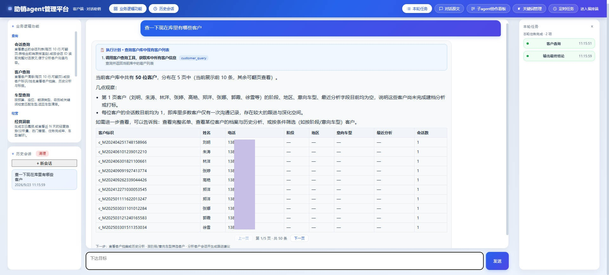
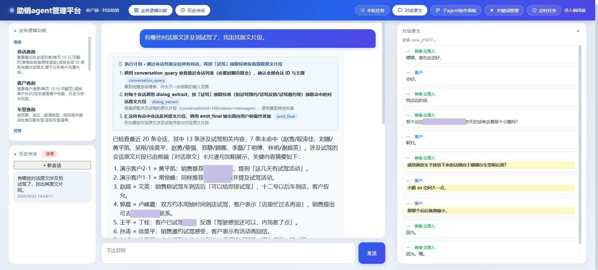
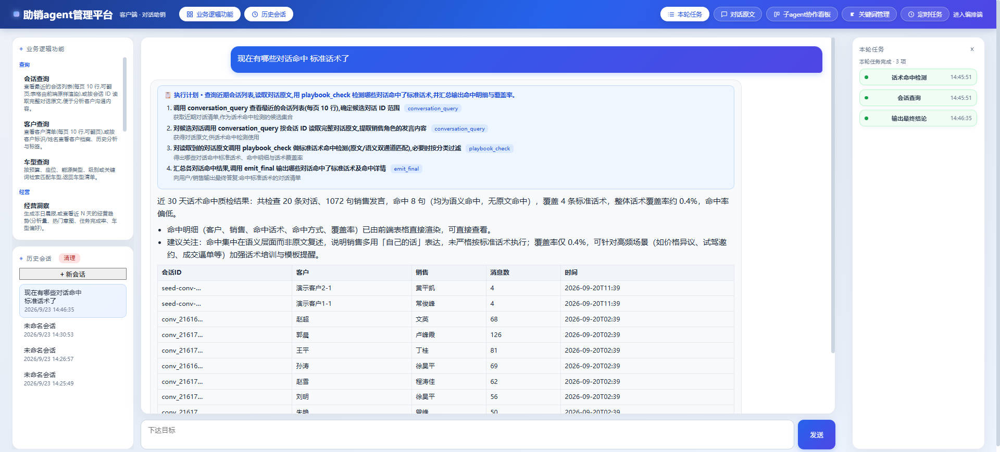
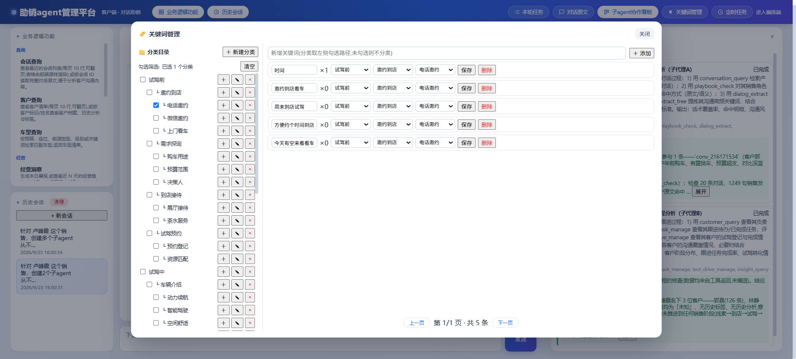
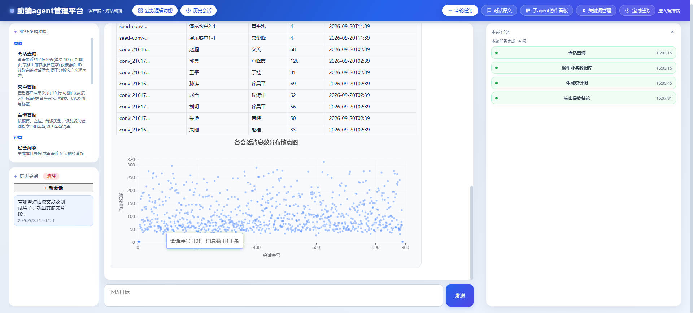
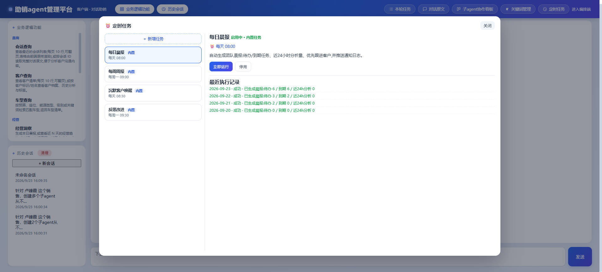
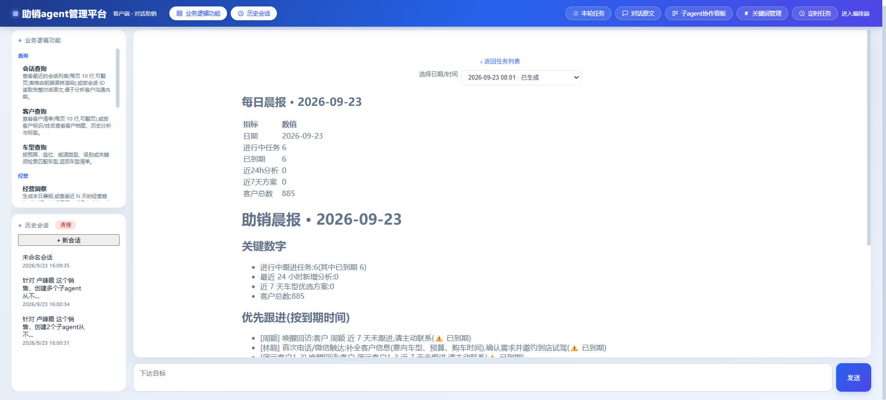
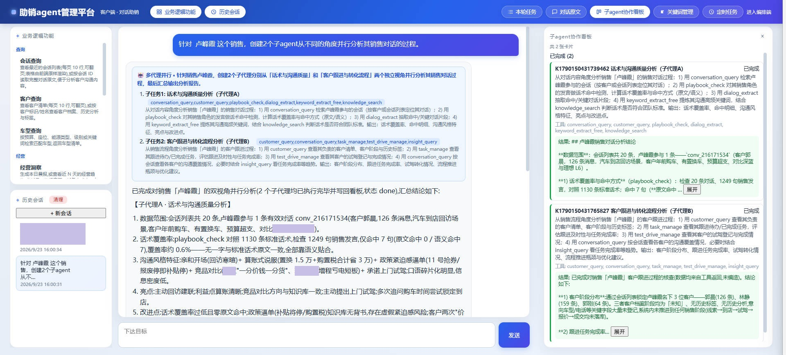

# 助销 agent 管理平台

面向销售团队的助销 agent 平台。以会话、客户、话术与知识库为底座,支持多代理协作、工作流沉淀、工具编目与中英双语工具召回。

# 界面截图

### 简单查询
会话/客户查询等基础能力,结果以表格呈现并支持翻页。



### 对话原文抽取
按抽取标准从对话中保真定位并高亮命中片段。



### 标准话术检测
把销售发言与标准话术做原文/语义双通道匹配,输出命中明细与覆盖率。



### 关键词管理
三级分类目录 + 勾选筛选 + 关键词增删改查。



### 绘图和表格
模型直接生成图表,表格由前端控件原样渲染。



### 定时任务
定时任务管理:内置任务与自定义任务,可查看执行记录与结果。



### 晨报
每日晨报与经营趋势:待办/到期任务、分析量、意图分布。



### multi agent 模式
多代理并行分析:主代理拆分任务,子代理并行执行,看板协作。



# 适用范围与设计取向

平台围绕**销售通用能力**构建:会话、客户、话术与知识、跟进任务、工作流沉淀、多代理协作、呈现与系统工具。车型目录、试驾、意向车型这类具体业务字段不进入平台,业务差异通过配置、工作流与知识库表达。

- **多租户**:所有业务表按 `tenant_id` 隔离,查询层与 `sql` 工具都以当前租户为准。
- **工具即目录**:工具是 `tools/`、`tools_system/` 下的目录(`readme.json` + `main.ts`);模型工具列表、能力清单、控制台开关都从目录派生,加工具不需要改后端代码。
- **配置零默认值**:运行参数只来自 `help-sale.config.yaml`,缺失即报错并指出具体配置键。
- **按内容命名**:功能逻辑与路由同文件放在 `services/routes/`,跨功能通用函数留在 `services/`。
- **语言一致的检索**:工具描述使用中文,外部 MCP 工具按其自身语言;检索按描述语言分池召回,模型不需要猜工具是哪种语言写的。
- **可评测**:`opimize/` 保存固定语料与跑分脚本,检索/召回/参数权衡都有可复现的数字。
# 技术栈

- Node.js ≥ 24(`node:sqlite`)+ TypeScript + Fastify + Vitest
- [pi(0.84.1, earendil-works)](https://github.com/earendil-works/pi) agent 运行时的本地 workspace 构建
- SQLite(默认,含 FTS5 trigram 中文检索)或远程 MySQL(配置切换);Milvus 作为可选向量旁路
- 本地轻量中文向量模型 `Xenova/bge-small-zh-v1.5`(缓存于 `data/models`,缺失时自动回退字符 n-gram)
- 模型:OpenAI 兼容端点,配置驱动(当前指向本地网关 `local-llm` provider)

# 目录结构

```
backend/
  server.ts / app.ts        Fastify 服务入口与路由注册
  env.ts                    配置出口(汇总 configs/ 各段)
  configs/                  配置解析:每个文件对应 yaml 的一段,无默认值
  prompts/                  提示词:系统/规划/协调/工具编目/查询改写
  services/routes/          HTTP 路由(每个文件一个功能域,逻辑与路由同文件)
  services/                 跨功能通用函数(向量库、记忆、时间线、分块、日志…)
  integrations_pi/          pi agent 运行时适配 + 数据表(agents/crm/knowledge/sales/analysis/automation)
  integrations_db/          中间件适配(Redis 到期提醒队列)
  db/                       表结构、迁移、MySQL 客户端
  mcp/                      MCP 客户端 + 工具编目 + 检索(词面 BM25 + 语义 BGE)+ 双语 query 改写
tools/ tools_system/        目录契约工具(readme.json + main.ts),新增工具只需加目录
3party/weixin/              微信 iLink 接入:扫码登录、长轮询收消息、发送、绑定与审计
front/                      前端页面(client.html 业务端 / console.html 控制台,含微信登录入口) + vendor(echarts/mermaid/marked/purify/qrcode)
scripts/                    启动、模型下载、数据导入
opimize/catalog/            检索评测:语料、跑分脚本、报告
```

# 快速开始

```bash
npm ci --prefix pi --ignore-scripts
node scripts/gen-minimal-model-data.mjs        # 离线模型数据(models.dev 不可达时)
npm run build:offline --prefix pi
npm install --ignore-scripts                    # 根 workspace 链接 pi 包
npm test                                        # 30 个测试文件 / 205 个用例
npm run typecheck && npm run typecheck:eval
```

开发服务:

```bash
npm run dev                                     # 监听 help-sale.config.yaml 里的 host:port
```

Windows 一键重启(端口、日志目录都从 yaml 读,不用改脚本):

```powershell
powershell -ExecutionPolicy Bypass -File scripts\restart-service.ps1
```

- 服务默认监听 **3101**(`server.port`),健康检查 `GET /api/v1/health`;
- 日志目录由 `logging.dir` 决定(默认仓库根下 `log/`):`service.log` / `service.err.log` / `runtime.log` / `model-calls.log`;
- 本地向量模型缺失时先跑 `node scripts/download-bge.mjs`(走 hf-mirror)或把已有 `data/models` 复制过来。

# 配置

所有运行时配置集中在仓库顶层 **[help-sale.config.yaml](help-sale.config.yaml)**,YAML 格式、支持注释。**每个字段都是必填**:代码里没有任何默认值,缺一项就在启动时报错并指出配置键;要"关掉/留空"请显式写 `false` / `""` / `[]` / `{}`。模板见 [help-sale.config.example.yaml](help-sale.config.example.yaml)。唯一的环境变量是 `CONFIG_PATH`,用于指定另一份配置文件。

主要配置段:

| 段 | 作用 |
| --- | --- |
| `server` | 监听地址与端口 |
| `data` | 存储模式(`local`=SQLite / `mysql`=远程 MySQL)、库标识、业务表名映射、数据目录与库文件路径 |
| `tenant` | 默认租户(请求未带 `x-tenant-id` 时使用) |
| `model` | 模型名/端点/密钥/代理/上下文窗口/`extraBody` |
| `context.compression` | 长对话增量压缩阈值 |
| `chunker` | 知识分块大小与重叠 |
| `tools.webSearch` | Serper 密钥(`web_search` 工具的启用门槛) |
| `tools.fileWrite` | 文件写入工具是否允许写到仓库之外(`allowOutsideRepo`) |
| `tools.catalog` | 工具编目与召回,见下 |
| `tools.sql` | SQL 工具的行数上限、执行超时、追加拦截关键字(见「SQL 执行策略」) |
| `weixin` | 微信 iLink 通道:登录凭据、租户、分片长度、发送重试、轮询超时、去重窗口、agent 超时、确认语、兜底话术、会话命令开关与条数、允许的联系人(见「微信接入」) |
| `mcp.servers` | 外部 MCP Server 列表 |
| `knowledge.searchLimit` | 知识检索默认条数 |
| `vector` / `milvus_backend` / `milvus_docker_compose` | Milvus 旁路与单机部署参数 |
| `workflows.mine` | 工作流挖掘参数(回溯天数、窗口、最小次数、返回条数、提炼条数、去重) |
| `logging` | 日志开关、目录、级别、运行日志文件名、单文件上限 |
| `subagents` | 多代理并发、轮询间隔、超时、子代理默认工具 |
| `defaults` | 各工具/接口的默认条数与窗口(洞察天数、列表条数、提醒批大小…) |
| `mysql` / `redis` | 中间件连接与开关 |
| `notification` | 到期提醒推送开关与 Webhook |
| `automation` | 定时任务:晨报、周报、沉默客户唤醒的时间与开关 |
| `company` / `userkey` / `client` | 公司名(写入提示词)、调用方标识、前端注入参数 |

# Agent 运行流程

```
用户提问(中文/英文)
  └─ 组装本轮工具:目录工具直挂;MCP + 工作流作为"长尾"
       ├─ 长尾 ≤ threshold:全部直挂,不做改写
       └─ 长尾 > threshold:进编目模式
            ├─ query 改写(1 次模型调用)→ { zh: 中文检索词, en: English keywords }
            ├─ zh 检索词 → 只在「中文描述」的工具池召回(词面 BM25 + 语义 BGE,下限 semanticFloorZh)
            ├─ en 检索词 → 只在「英文描述」的工具池召回(同双通道,下限 semanticFloorEn)
            ├─ search_tools 把两段分开返回给模型:【中文描述的工具】+【英文描述的工具】
            └─ 模型选工具 → get_tool_details 取参数 → call_tool 执行
  └─ 轨迹、工具调用与工作流步骤写入 agent_events,前端时间线可回放
```

几个设计点:

- **工具描述语言**(`description_language`,zh/en)决定它进哪一段:现有 32 个本地目录工具与已沉淀工作流都是**中文**描述(zh),外部 MCP 工具一般按英文描述提供(en);`readme.json` 里可显式声明,缺省按描述文本推断。
- **两段不混排**:跨语言谁更相关交给模型按描述判断 —— 两段的第一名分数在融合里相同,合成一条榜单只能按工具名猜,实测会错。
- **改写只触发一次**:超时、解析失败或开关关闭都会退回用户原话,不阻塞本轮。
- 模型自己那次 `search_tools` 的 query 也算一路,按语言并入对应那一段。
# 工具契约(目录工具)

`tools/` 与 `tools_system/` 下每个工具是一个目录,含:

```json
{
  "name": "conversation_query",
  "label": "会话查询",
  "description": "查看最近的会话列表(每页 10 行,可翻页;表格由前端原样渲染),或按会话 ID 读取完整对话原文。",
  "description_language": "zh",
  "category": "查询",
  "parameters": { "type": "object", "properties": { "view": { "type": "string" } } },
  "entry": "main.ts",
  "function_list": ["main.execute"],
  "requires": [{ "kind": "config", "key": "tools.webSearch.apiKey", "present": true }],
  "hidden": false
}
```

- `main.ts` 导出 `execute(ctx, params)`(或 `default.execute`),`ctx` = `{ db, tenantId, webSearchApiKey }`;
- `requires` 是环境门槛(配置/环境变量/数据库),不满足时该工具隐藏;
- `hidden: true` 的工具不出现在能力清单(模型仍可调用);
- 新增/修改工具**重启服务即生效**,不需要改后端代码。

当前挂载的本地工具(32 个):`conversation_query`、`customer_query`、`insight_query`、`knowledge_search`、`knowledge_ingest`、`knowledge_candidate`、`playbook_check`、`task_manage`、`workflow_manage`、`browser`、`chart_generate`、`cluster`、`computer`、`date_tool`、`dialog_extract`、`embedding`、`excel`、`file_read`、`file_write`、`kanban`、`keyword_extract_free`、`keyword_extract_strict`、`ppt`、`redis`、`similarity`、`sql`、`subagents`、`table_generate`、`terminal`、`txt`、`update_memory`、`web_search`(需配 Serper 密钥)。

# 文件读写方案(file_read / txt / file_write)

模型要改文件时,最大的风险不是"不会写",而是**拿着过期内容去写**:读完之后文件被别人(或别的步骤)改了、或者行号数错了。所以这套工具按"乐观锁 + 行号锚点"设计。

三个工具分工:

| 工具 | 作用 | 读/写 |
| --- | --- | --- |
| `txt` | 读**仓库内**文本文件(txt/md/csv/json/yaml/log/xml/html) | 读 |
| `file_read` | 读**任意路径**文件;文本文件带行号/哈希,Excel/PDF/PPT/DOCX 只做文本抽取 | 读 |
| `file_write` | 写文本文件:`create` 新建、`replace` 整份替换、`patch` 按行号局部修改 | 写 |

## 读:`txt` / `file_read` 返回什么

文本文件一律带**绝对行号 + 总行数 + 内容 hash + 换行风格**,拿到的 hash 可以直接当写操作的 `expectedHash`:

```
文件:E:\proj_help_sale_v2\.tmp\smoke.md
共 3 行 · hash=f97871a36f51 · 换行=LF
1| # 标题
2| 第一段
3| 第二段

(修改请用 file_write:op=patch 按行号改,或 op=replace 整份替换,并带上 expectedHash=f97871a36f51)
```

- 行号是**文件里的绝对行号**(不是分页内的相对序号);
- `txt` 用 `startLine` / `maxLines`(默认 200 行)分页,截断时会写"仅显示第 X-Y 行,继续读传 startLine=…",避免模型拿截断内容去算行号;
- Excel / PDF / PPT / DOCX 只抽取文本,结果里明确写"不提供行号与 hash,不能用 file_write 编辑"。

## 写:`file_write` 的三种模式

| op | 用途 | 必填参数 |
| --- | --- | --- |
| `create` | 新建文件;文件已存在则**拒绝**,并回当前 hash 提示改用 `replace` | `content` |
| `replace` | 整文件替换 | `content` + `expectedHash` |
| `patch` | 按行号局部修改(可一次多条,原子应用) | `expectedHash` + `edits[]` |

`patch` 的每条 edit:`{ startLine, endLine?, content, expect? }`

| 字段 | 约定 |
| --- | --- |
| `startLine` | 从 **1** 开始 |
| `endLine` | 省略 = 只改这一行 |
| `content` | 替换成的内容;传空串 `""` = **删除**该区间 |
| `expect` | 该区间当前原文(建议填):与实际内容不一致就直接拒绝,防止行号数错写错位置 |

三层校验,任何一层不过都不落盘:

1. **哈希 CAS**:`expectedHash` 与文件当前 sha256 不符 → 说明内容被改过,拒绝并回当前 hash + 行数,要求重读;
2. **行号边界**:越界、`startLine > endLine`、区间重叠、对空文件 patch → 拒绝并说明原因;
3. **原文锚点**:`expect` 与目标区间实际内容不一致 → 拒绝并**把实际内容贴出来**。

工程细节:

- **写入必回新 hash**(12 位短 ID,也接受完整 sha256 或 ≥8 位前缀),模型可连续编辑而不必反复读文件;
- **换行风格与 BOM 原样保留**(CRLF 文件改完还是 CRLF,带 BOM 还是带 BOM),避免一次小改在 git 里变成整文件 diff;
- **原子写**:同目录临时文件 + rename,失败会清理临时文件;
- **保护**:内容上限 2MB、含 NUL 字节拒绝、`create` 用 `wx` 语义(存在即失败);
- **路径范围**由配置决定:`tools.fileWrite.allowOutsideRepo: true` 允许任意本地路径;设为 `false` 时只接受仓库内路径,越界直接拒绝。

## 典型调用链

```
1) txt(filePath="src/a.ts")                    → 行号 + 总行数 + hash=ab12cd34ef56
2) file_write(op=patch, expectedHash="ab12cd34ef56",
              edits=[{ startLine: 12, endLine: 14, content: "新内容", expect: "原第 12-14 行" }])
   → 已局部修改…hash=99aa88bb77cc(旧 ab12cd34ef56)
3) 需要再改就带 99aa88bb77cc 继续;若中途文件被改过,第 2 步会返回 CAS 未通过
```

## 常见返回与含义

| 返回 | 含义 / 下一步 |
| --- | --- |
| `文件已存在,不能新建…hash=xxx` | 改用 `op=replace` + 该 hash |
| `编辑现有文件必须带 expectedHash` | 先读文件拿 hash |
| `文件内容已变更,拒绝写入(CAS 未通过)` | 内容已变,重新读取后再改 |
| `edits[i] 原文校验失败:第 X-Y 行实际是…` | 行号对不上,重读确认行号 |
| `edits 有重叠…请合并成一段` | 合并相邻/重叠区间 |
| `文件是空的,patch 没有可改的行` | 改用 `op=replace` 写整份内容 |

# SQL 执行策略(sql 工具)

`sql` 工具默认只读,所有守卫都在 `backend/services/sql-policy.ts`,执行层只负责"跑、截断、审计、超时"。

| 防线 | 规则 |
| --- | --- |
| 只读默认 | 只有 `SELECT/SHOW/EXPLAIN/DESCRIBE/PRAGMA` 直接放行;写操作必须 `readOnly=false` **且** `confirmWrite=true` |
| 语句黑名单 | `DROP / TRUNCATE / ALTER / CREATE / RENAME / GRANT / REVOKE / ATTACH / DETACH / VACUUM / REINDEX / ANALYZE / SHUTDOWN / KILL / FLUSH / RESET / INSTALL / UNINSTALL / LOCK / UNLOCK / HANDLER / LOAD / CALL / SET` 一律拒绝;`tools.sql.extraBlockedKeywords` 可再追加(整句扫描,如 `union`) |
| 危险写法 | `LOAD_FILE()` / `INTO OUTFILE|DUMPFILE` / `LOAD DATA` / `BENCHMARK()` / `SLEEP()` / `pg_read_file()` |
| 多语句 | 一条 `;` 后面还有内容就拒绝 |
| MySQL 可执行注释 | 出现 `/*! … */` 直接拒绝(服务端会把它当语句执行,是最常见的绕过手法) |
| **WITH 主语句** | 首词是 `WITH` 时,按声明之后的**主语句**(SELECT/INSERT/UPDATE/DELETE/REPLACE)判定,`WITH … DELETE` 不能借 CTE 逃过 WHERE 检查 |
| WHERE 必填 | `UPDATE/DELETE` 必须带 `WHERE` |
| 恒真条件 | `WHERE 1=1` / `true` / `0=0` / 空串比较 / `OR 1=1` 一律拒绝(只读语句不受限) |
| **PRAGMA 白名单** | 只允许 `table_info / table_xinfo / index_list / index_info / index_xinfo / foreign_key_list / database_list / compile_options`;带 `=` 的赋值式(如 `writable_schema=ON`)拒绝;MySQL 方言下 PRAGMA 直接拒绝(改查 `information_schema`) |
| **租户隔离** | 语句涉及业务表(`data.tables` 里除 `tenants` 外的表)时,必须用 `:tenantId` 占位符,由工具注入当前租户;`tenant_id = 't_other'` 这种写死值直接拒绝 |
| 行数上限 | 读语句没写 `LIMIT` 时自动补 `LIMIT tools.sql.maxRows`;结果按同一上限截断(超出会标注) |
| 执行超时 | `tools.sql.timeoutMs`:MySQL 作为查询超时传给驱动;SQLite 放进 worker 线程执行,超时直接终止(同时避免同步 API 卡住主线程) |
| 审计 | 读、写、被拦截、执行失败都追加 JSONL 到 `data/sql-audit.log`(含租户、SQL、模式、行数/错误) |

租户隔离的写法(工具会自动把 `:tenantId` 换成 `?` 并注入当前租户,`values` 里不要放租户):

```sql
SELECT * FROM customers WHERE tenant_id = :tenantId AND name LIKE ?
-- values: ["%张%"]
```

配置(`help-sale.config.yaml`):

```yaml
tools:
  sql:
    maxRows: 200              # 单次读取上限(读语句自动补 LIMIT,结果也按它截断)
    timeoutMs: 15000          # 单条 SQL 超时
    extraBlockedKeywords: []   # 在内置黑名单之外追加拦截关键字
```

数据库账号的最小权限建议见 `scripts/mysql-grants.sql`:读写账号只给 `help_sale` 库的 `SELECT/INSERT/UPDATE/DELETE`,`root` 只用于首次建表(启动自检发现缺列时只会告警,不执行 DDL)。

已知边界:

- `WHERE` 只做"有/无 + 恒真"判定,不做语义分析 —— `WHERE status <> '不可能的值'` 这类仍然能全表命中;
- 每次调用 `sql` 建立一次 MySQL 连接(握手约 3s),面向低频分析型查询;
- 结果给模型的文本截断在 8000 字符,`details.rows` 按 `maxRows` 截断。
# MCP 接入与工具编目

- 在 `mcp.servers` 配外部 MCP Server(含 `pat` 时自动带 `Authorization: Bearer`),它们的工具以 `mcp_{server}_{tool}` 前缀混进工具列表;
- 工具列表按 URL 缓存 5 分钟,传输层对"连不上"重试 3 次;
- 外部工具元数据**含中文会打告警**:这类工具会被判为 `description_language=zh`,只参与中文那一路召回;
- 长尾工具(MCP + 工作流)超过 `tools.catalog.threshold` 时按需取用:模型先用 `search_tools` 检索候选,再 `get_tool_details` 取参数,最后 `call_tool` 执行。

# 微信接入(iLink 机器人)

`3party/weixin` 把微信接到同一条 agent 链路上:扫码登录一个 iLink 机器人账号,长轮询收微信消息,跑一轮 agent,再把回答发回微信。收发都走 `ilink/bot/*` 协议,不依赖公众号后台配置。

三步用起来:
控制台(**/console**)的「微信」标签页就是入口:顶部显示是否登录、是否在轮询、账号、已处理条数与最近错误,一键获取登录二维码、刷新状态、退出登录,下方列出联系过的微信用户并可直接绑定销售或客户。二维码由页面内置的 `front/vendor/qrcode.js` 本地渲染,不调用任何外部服务。

命令行等价操作:

1. `weixin.enabled: true`,其余键照常配齐(`baseUrl`、`tenantId`、分片长度、超时、允许的联系人);
2. `GET /api/v1/weixin/login` 拿二维码(`qrcodeUrl` 直接用微信扫),轮询 `GET /api/v1/weixin/login/:id` 到 `status=confirmed`,凭据落盘 `data/weixin/account.json`,轮询器自动启动;3. 在微信里给这个账号发消息,系统按"一条微信消息 → 一条 agent 线程 → 一条回复"处理。

| 接口 | 作用 |
| --- | --- |
| `GET /api/v1/weixin/status` | 是否启用、是否已登录、轮询是否在跑、最近一次轮询时间与错误 |
| `GET\|POST /api/v1/weixin/login` | 取登录二维码(控制台按钮走这条路) |
| `GET /api/v1/weixin/login/:id` | 轮询扫码状态(wait / scaned / confirmed / expired) |
| `POST /api/v1/weixin/logout` | 停掉轮询并清空内存里的账号 |
| `POST /api/v1/weixin/send` | 主动发消息:`{ to, text }` |
| `GET /api/v1/weixin/users` | 最近联系过系统的微信用户及其绑定关系 |
| `POST /api/v1/weixin/bind` | 把 openid 绑到销售或客户:`{ openid, kind: sales\|customers, id }` |
| `GET /api/v1/weixin/messages` | 收发审计(方向、状态、线程、错误) |
| `GET /api/v1/agent/threads/stream` | 会话事件流(SSE):微信侧写入消息/改标题时推给网页端 |

行为约定:

- **单 Agent 直答**:微信侧不启用规划与看板子代理,一条消息只跑一轮 agent 并直接出结果 —— 聊天渠道没有网页端那套流式界面,也没有人来触发多代理汇总;
- **先确认再回答**:收到消息立刻回一条 `weixin.ackText`(留空则不回),agent 跑完再回正式答复。确认语在入队时就发,同一联系人连发多条也不会等到上一条跑完才有反馈;
- **会话立刻可见**:线程在收到消息时就建好并写入本轮用户消息、用消息内容起标题,网页历史里点开就能看到提问,不用等 agent 结束;
- **微信里的命令**:`/help`、`/new`、`/sessions`、`/switch <序号>`、`/compact`、`/clear`、`/stop`、`/status`、`/whoami`、`/bind <sales|customers>:<编号>`,中文别名同样可用(`/新会话`、`/会话`、`/压缩`…)。命令在入队前就处理,所以 agent 还在跑时 `/stop` 也能立刻生效;
- **网页同步**:微信里发出的消息与系统回答会通过 `GET /api/v1/agent/threads/stream`(SSE)推给网页端 —— 历史列表自动刷新,正在打开的那条会话直接把新消息追加到对话里,不用手动刷新;
- **按联系人串行**:同一个 openid 的消息排队处理,两条消息同时到也不会把一条线程写乱;
- **幂等**:`message_id` 记在 `weixin_messages`,重投递直接跳过;
- **context_token 回带**:每条出站消息带该联系人最新的 `context_token`;失效(-14 / -2 "unknown error")时自动去掉 token 重试一次;
- **微信可读文本**:回复前把 Markdown 转成纯文本(标题去标记、表格拆成 `客户 · 金额` 行、链接保留地址),再按 `weixin.maxMessageLength` 分条;
- **非文字消息**回 `weixin.unsupportedText`;agent 失败或超时(`weixin.agentTimeoutMs`)同样回这句;
- **绑定后才带身份**:已绑定销售/客户的联系人,进入 agent 的 goal 会带一行 `(微信联系人已绑定 sales:xxx)`,提示词据此判断是谁在问;
- **审计**:收到、回复、失败、被 `allowFrom` 拦下都写 `weixin_messages`。

agent 侧另有 `weixin_send` 工具(`action=send|list`),可以主动给人发消息,和收消息回复共用同一套发送实现。

已知边界:只处理文字;群消息是否送达取决于 iLink 对该账号的投递策略;令牌过期或被踢下线需要重新扫码。
# 工作流沉淀

`workflow_manage` 管理"执行轨迹 → 可复用工作流"的链路:

- `op=mine`:从历史 `agent_events` 挖掘高频工具串联,产出待审批草稿(参数在 `workflows.mine`);
- `op=list / approve / reject / disable / check`:查看、晋升、驳回、停用启用、静态自检步骤工具是否可用;
- 只有 `status=enabled` 的工作流才会作为 `workflow_<id12>` 工具挂给模型(质量顺序:草稿 → 审批 → 挂载);
- 挂载前会校验步骤引用的工具在当前环境确实加载,不通过则不挂载并在日志点名;
- 工作流的中文名字/描述由挖掘提炼产出,按中文描述参与检索;人工在控制台新建的同样支持中英两种描述。

# 多代理与看板

- `subagents` 工具登记子代理任务,`kanban` 作为主/子代理之间的通信总线(按会话隔离);
- 规划器提示词决定 `single` / `multi`;协调者提示词负责汇总看板结果;
- 并发、轮询间隔、超时、子代理默认工具都在 `subagents` 段配置。

# 知识与话术

- `knowledge_search` / `knowledge_ingest` / `knowledge_candidate`:知识库检索、沉淀候选、审批入库;入库时按 `chunker` 分块并写入 FTS5 trigram 全文索引;
- `playbook_check`:话术命中检测,对会话原文做"原文 + 语义"双通道匹配,输出命中明细与覆盖率;
- `vector` 段开启且 `provider=milvus` 时,知识分块向量写入 Milvus,语义命中走向量检索;`/api/v1/knowledge/vector-*` 提供状态与重建索引。

# 定时任务与通知

- `automation` 段:晨报、周报、沉默客户唤醒的时间与开关,以及是否启用调度器;
- 内置任务与自定义任务都可通过 `/api/v1/automations*` 查看、触发、改期;
- 到期提醒:开启 `redis` 时走 Redis 队列(关闭则退化为内存队列),`notification.webhookUrl` 非空时推送 JSON。

# 数据存储

- `data.mode=local`:SQLite(默认),库文件在 `data.businessDbPath`,会话库在 `sessionDbPath`;
- `data.mode=mysql`:业务表走远程 MySQL,建表语句在 `backend/db/mysql/schema.sql`;
- 业务表名统一在 `data.tables` 映射(租户、客户、会话、消息、待办、知识、候选、事件、标签、通知、门店、销售、成交、工具缓存、日报);
- SQLite 迁移由 `backend/db/migrate.ts` 的 `MIGRATION_VERSION` 推进;`mysql.schemaRebuild=true` 会先删表再建(仅初始化/结构升级用,会清空远程业务表)。

# HTTP API 一览(前缀 /api/v1)

| 域 | 主要接口 |
| --- | --- |
| Agent | `POST /agent/run`、`POST /agent/threads`、`GET /agent/threads/:id`、`POST /agent/threads/:id/run-stream`、`POST /agent/threads/:id/stop`、`GET /agent/:runId/timeline`、`GET /agent/capabilities` |
| 工作流 | `GET/POST /workflows`、`PUT/DELETE /workflows/:id`、`POST /workflows/mine`、`POST /workflows/:id/approve|reject|check`、`GET /workflows/:id/runs` |
| 知识 | `GET /knowledge/search`、`GET /knowledge/semantic-search`、`GET /knowledge/candidates`、`POST /knowledge/candidates/:id/approve|reject`、`GET /knowledge/vector-status`、`POST /knowledge/vector-reindex` |
| 客户/会话 | `GET /conversations`、`GET /conversations/:id/transcript`、`GET /conversations/:id/timeline`、`GET /customers/:key/tags`、`POST /customers/:key/funnel` |
| 销售/门店 | `GET /sales`、`GET /sales/:id/workbench`、`GET /stores`、`GET /stores/:id/overview|performance|funnel|silent-customers`、`GET/POST /deals` |
| 任务/提醒 | `GET /tasks`、`GET /reminders/overdue` |
| 控制台 | `GET /console/logs`、`GET /console/workflows`、`PUT /console/capabilities/:name`、`GET /agent/capabilities` |
| 其他 | `GET /health`、`GET /reflections`、`POST /reflections/apply`、`GET/POST/PUT/DELETE /keywords*`、`/keyword-categories*`、`GET /notifications`、`POST /notifications/trigger`、`GET/POST /subagents`、`POST /subagents/run`、`GET /kanban`、`/automations*`、`/assistant/*` |

# 测试与评测

```bash
npm test                 # 30 个测试文件 / 205 个用例
npm run typecheck        # backend 业务代码
npm run typecheck:eval   # 仓库根,额外覆盖 opimize/ 下的评测脚本
```

检索评测在 `opimize/catalog/`,三套语料各有脚本与报告,直接跑:

```bash
node_modules\.bin\tsx.cmd opimize/catalog/run-eval-recall.ts   # 100 条中文 query 的召回率(recall@1/3/5/8)
node_modules\.bin\tsx.cmd opimize/catalog/run-eval.ts          # 业务测试集:单条 query 四方案 vs 双语召回
node_modules\.bin\tsx.cmd opimize/catalog/run-eval-large.ts    # 干净基准:100 英文 MCP + 100 中文工作流
```

# 常见问题

- **改了工具没生效?** 目录工具是启动时扫描的,重启服务即可(`scripts/restart-service.ps1`)。
- **服务端口/日志在哪?** 都从 `help-sale.config.yaml` 读:端口看 `server.port`,日志看 `logging.dir`(默认 `log/`)。
- **启动报"缺少配置项 xxx"?** 这是刻意设计 —— 该键必须在 yaml 里显式给出,包括空值也要写 `""` / `[]`。
- **MCP 工具检索不准?** 先看日志有没有"元数据含中文"的告警;外部工具按英文描述设计,中文元数据只会走中文那一路召回。
- **本地向量模型没下载?** 语义通道会自动回退字符 n-gram 向量(能跑但效果下降),按"快速开始"里的命令补下载。
- **工作流没有出现在工具列表?** 只有 `status=enabled` 且步骤工具都可用的工作流才会挂载,`workflow_manage(op=check)` 可以自检。
